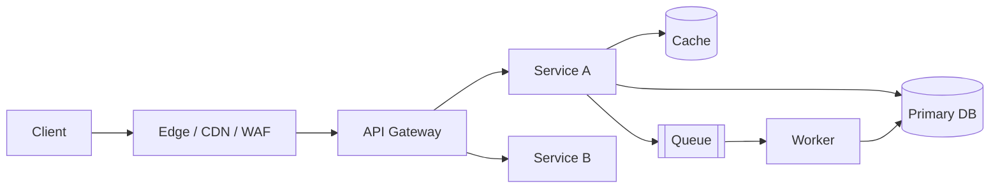

# System design answer template

> Copy this file per practice prompt. Time-box to 45 minutes. Write it, don't just think it.

## 1. Problem
-

## 2. Requirements
**Functional**
-

**Non-functional**
- Availability SLO:
- Latency SLO (p50/p95/p99):
- Durability / RPO / RTO:
- Consistency model:
- Compliance / data residency:

## 3. Scale estimates
| Metric | Value | Derivation |
|---|---|---|
| DAU / requests per day | | |
| Average QPS | | |
| Peak QPS (2–5x) | | |
| Read:write ratio | | |
| Storage per day / per year | | |
| Bandwidth | | |
| Working set (cacheable) | | |

## 4. API surface
```
POST /v1/...
GET  /v1/...
```

## 5. Data model & storage choice
- Entities / access patterns:
- Store chosen and why (vs alternatives):
- Partition key and why:
- Indexes:
- Hot-key mitigation:

## 6. High-level architecture


## 7. Deep dive
-

## 8. Reliability analysis

| Component | Failure mode | Detection | Mitigation | Blast radius |
|---|---|---|---|---|
| | | | | |

- SLIs and where they're measured:
- Error budget policy:
- Overload behaviour (shed / queue / degrade):
- Retry policy (backoff, jitter, budget, idempotency):
- Multi-region strategy and failover runbook:

## 9. Operability
- Deployment strategy & rollback:
- Key dashboards:
- Top 5 alerts:
- Runbooks needed:
- On-call load expectation:

## 10. Cost
- Main cost drivers:
- Levers to reduce:

## 11. Trade-offs made / what I'd do with more time
-
