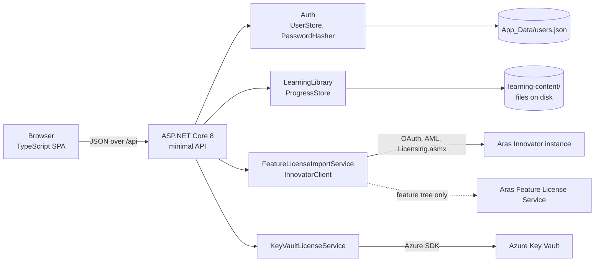
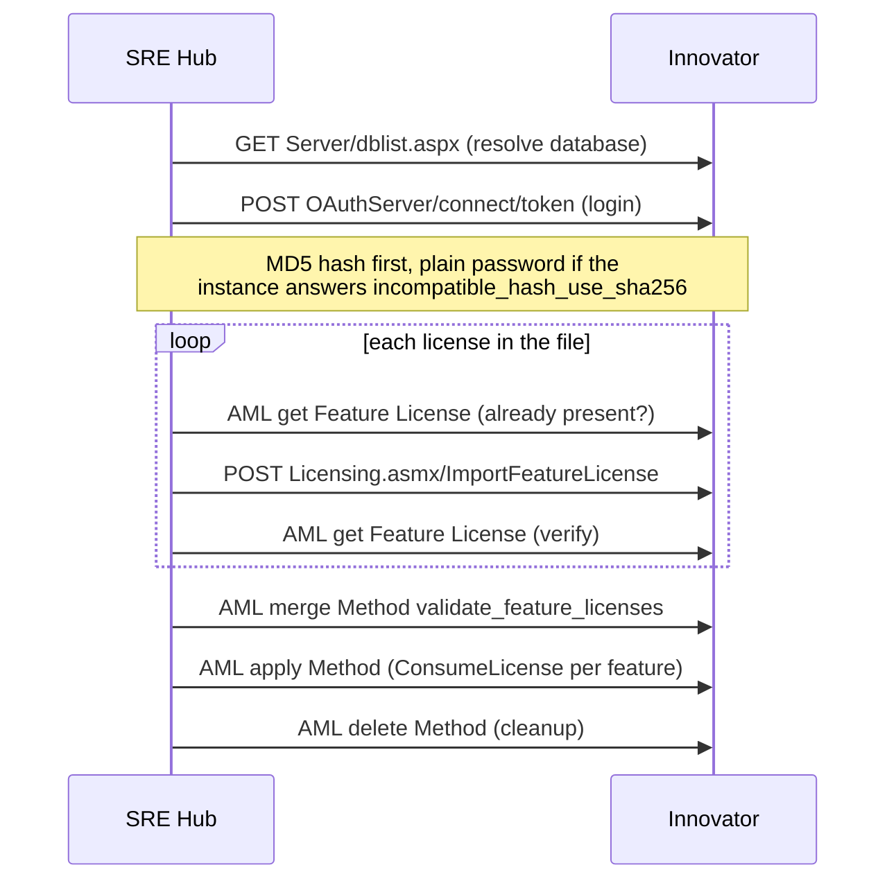

# SRE Hub

SRE Hub is an internal web application for Aras Corporation SRE work. It combines two things in one place:

1. **A personal learning library** for markdown study notes, with search, progress tracking and flashcards.
2. **Aras operations tooling** for working with Aras Innovator feature licenses and Azure Key Vault license secrets.

It runs locally (`http://localhost:5280`), needs no database, and is built with an ASP.NET Core 8 minimal API and a
framework-free TypeScript front end.

## Contents

- [SRE Hub](#sre-hub)
  - [Contents](#contents)
  - [What it does](#what-it-does)
  - [How the application is organised](#how-the-application-is-organised)
  - [Learning library](#learning-library)
    - [Reading and practising](#reading-and-practising)
    - [Managing content](#managing-content)
  - [Aras operations](#aras-operations)
    - [1. Feature license operation](#1-feature-license-operation)
    - [2. Add / update Key Vault secrets](#2-add--update-key-vault-secrets)
  - [How it works](#how-it-works)
    - [Architecture](#architecture)
    - [Feature license import flow](#feature-license-import-flow)
    - [Update feature tree flow](#update-feature-tree-flow)
    - [Learning file operations](#learning-file-operations)
  - [Sign in and security](#sign-in-and-security)
  - [Getting started](#getting-started)
  - [Configuration](#configuration)
  - [API reference](#api-reference)
  - [Project layout](#project-layout)
  - [Helper scripts](#helper-scripts)
  - [Troubleshooting](#troubleshooting)
  - [Known limitations](#known-limitations)

## What it does

| Area | Capability |
|---|---|
| Learning | Browse subjects and files, render markdown, preview images and PDFs, search all content, practise with flashcards, track completion per file |
| Learning (admin) | Create, rename, move and delete subjects, folders and files; upload files; create and edit notes |
| Feature licenses | Import license keys into one or more Innovator instances, validate them, re-import, preview changes, and update the feature tree |
| Key Vault | Write license data from a license JSON file into an Azure Key Vault as secrets, with a preview mode |
| DO shift & OneNote | Quarter DO roster imported from the Monitoring Log sheet (who is DO on the Japan and India shifts), plus your own DO days, handovers and OneNote updates with missing-update reminders (Other menu) |
| Account | Local sign-in with lockout protection, profile menu with About and Sign out |

## How the application is organised

The left menu is a three-group tree. Each group collapses, the whole menu collapses to an icon strip, and both states
are remembered between visits.

```text
Learning
  01 - Subject ...            (one entry per subject folder, with progress)
  02 - Subject ...
Aras Operations
  1  Feature license operation
  2  Add / update Key Vault secrets
Other
  Reserved for future tools
```

The top bar holds the menu collapse button and the profile menu (About, Sign out).

## Learning library

The library is a folder of subjects on disk. Each top-level folder under the content root is one subject, and its
`README.md` supplies the title and description.

### Reading and practising

- **Browse** a subject through a collapsible file tree and a viewer. Markdown is rendered on the server with Markdig
  (raw HTML disabled). Text files, images and PDFs are previewed inline.
- **Search** the full text of every markdown and text file, across the whole library or one subject.
- **Flashcards** are built from the interview questions in the markdown files. Two shapes are recognised:

  ```markdown
  **Q: How would you define an SLO for a new service?**
  Start with user journeys, pick 2-4 SLIs, baseline for four weeks, then agree an error-budget policy.
  ```

  ```markdown
  ## Interview questions

  1. How do you manage Terraform state for 50 microservices across 4 environments?
  ```

  The first produces a card with an answer, the second a question-only card.
- **Progress** is a per-file "Completed" toggle. Subjects show a progress bar.

### Managing content

Every signed-in account has full rights. There are no separate roles.

| Action | Subjects | Folders | Files |
|---|---|---|---|
| Add | **+** in the menu | New folder | Upload, or New / edit note |
| Update | Rename | Rename | Edit, Rename |
| Move | - | Move | Move (to any folder in any subject) |
| Delete | Delete subject | Delete (including contents) | Delete |

Behaviour worth knowing:

- Subject order and the number shown in the menu come from the **folder name prefix** (for example `13-terraform`).
  Renaming the folder is how you reorder.
- Renaming, moving and deleting keep completion marks consistent, so progress counts stay correct.
- Renaming a file to a type that is not allowed for upload is rejected.
- Open a folder's actions with the `...` button that appears when you hover it in the file tree.
- Deleting is permanent and asks for confirmation first.

Allowed file types: markdown, text/config/script files (`.txt .yml .yaml .json .xml .csv .sh .ps1 .tf .py .sql` and
similar), images (`.png .jpg .gif .svg .webp`), `.pdf`, `.drawio`, `.zip`, `.docx`, `.pptx`, `.xlsx`.

## Aras operations

### 1. Feature license operation

Targets one or more Aras Innovator instances. Choose a **run mode**, enter the instance URLs and admin credentials, and
run. Results are shown per instance.

| Run mode | License file needed | What it does |
|---|---|---|
| Import missing licenses | Yes | Imports only keys that are absent or whose expiration differs, then validates |
| Re-import all licenses | Yes | Writes every key in the file again, even if already present |
| Validate only | No | Reads the Feature Licenses already on the instance and consumes each one to prove it works |
| Update feature tree + validate | No | Updates the feature tree, then validates every Feature License |
| Dry run | Yes | Reports what would change as `WouldUpdate` without touching the instance |

Other inputs:

- **License variant**: `auto` (build_ci for localhost, azure otherwise), `key_value_azure` or `key_value_build_ci`.
- **Only these key names** limits the import to named keys.
- **Database** is optional and only valid for a single instance.
- **Run license validation** is forced on for Validate only and Update feature tree, and off for Dry run.
- **Ignore TLS certificate errors** skips certificate validation for that run. Use it only on internal test instances.
- **Send the raw password** skips the MD5 hash on the first login attempt.

While a run is in progress the button and results area show a spinner. The result header shows the mode, variant,
instance and license counts, validation totals and duration, followed by a block per instance.

### 2. Add / update Key Vault secrets

Reads a license JSON file and writes it to an Azure Key Vault.

- Each `key_name` becomes a secret holding the value for the chosen variant. Characters outside `[0-9a-zA-Z-]` become `-`.
- Optionally writes a `framework_licenses` secret as well.
- Values that are already identical report `Unchanged`, so no new secret version is created.
- **Preview only** is on by default and reports `WouldUpdate` without writing anything.
- Authentication uses `DefaultAzureCredential`: run `az login`, or use a managed identity with the
  **Key Vault Secrets Officer** role on the vault.

## How it works

### Architecture



- **Front end**: plain TypeScript compiled by `tsc` into `wwwroot/js` and loaded as ES modules. There is no bundler or
  UI framework. Views are `<section>` elements switched by URL hash (`#learning`, `#import`, `#vault`).
- **Back end**: a single `Program.cs` mapping minimal API endpoints. Every endpoint except `/login.html` and its static
  assets requires a session cookie.
- **Storage**: the learning library is plain files. Completion state lives in `<content root>/.sre-hub/progress.json`.
  Accounts live in `App_Data/users.json`. There is no database.

### Feature license import flow

For each Innovator instance, in order:



The temporary server Method is created, run and deleted on every validation, and the cleanup outcome is reported as
**Method cleanup**. The validation output is parsed into a PASS/FAIL row per feature.

This mirrors the PowerShell tool in `../Licenses/Import-FeatureLicense.ps1`.

### Update feature tree flow

The flow follows the Innovator client's own `Licensing.UpdateFeatureTree` implementation:

1. `POST {instance}/Server/Licensing.asmx/GetServerInfo` and read `framework_license_key`.
2. SOAP `GetFeatureTree` to the Aras Feature License Service
   (`https://www.aras.com/productservices/FeatureLicenseService/FeatureLicenseService.svc`) with that key, which returns
   the encrypted feature tree.
3. `POST {instance}/Server/Licensing.asmx/UpdateFeatureTree` with `encryptedFeatureTree`.

The host running SRE Hub therefore needs outbound access to `www.aras.com`. See [Known limitations](#known-limitations).

### Learning file operations

All paths are validated segment by segment (letters, digits, spaces and `. _ -` only; no leading dot, no `..`) and the
resolved path must stay inside the subject folder. Rename and move refuse to overwrite an existing item or to move a
folder into itself. A case-only rename on Windows is handled through a temporary name.

## Sign in and security

- On first start, if no account exists, an administrator is created and the generated password is printed **once** to
  the console that started the app.
- Passwords are stored as **PBKDF2-SHA256** (210,000 iterations, 16-byte salt, 32-byte key) and compared in constant time.
  Unknown accounts still run the key derivation so timing does not reveal which emails exist.
- **5 failed attempts** per email and client trigger a **15 minute** lockout.
- The session is an `HttpOnly`, `SameSite=Strict` cookie with a 12 hour sliding expiry.
- Innovator credentials exist only for the duration of one request and are never written to disk or logged.
- Markdown is rendered with raw HTML disabled, so content files cannot inject script.
- There is no TLS. Run on `localhost` only, and put the app behind HTTPS before exposing it on a network.

Account commands:

```powershell
dotnet run -- hash-password                       # prompts, prints a pbkdf2.sha256$... hash
dotnet run -- set-password you@example.com        # prompts twice, writes the hash into App_Data/users.json
```

`set-password` creates the account if it does not exist. Accounts defined in configuration take precedence over
`App_Data/users.json`. Delete that file to force a fresh seeded administrator.

## Getting started

Prerequisites:

- .NET 8 SDK
- Node.js 18 or later (only to compile the TypeScript)
- For the Key Vault page: `az login`, or a managed identity with Key Vault Secrets Officer

```powershell
cd d:\ManagedServices\Work\SreHub
npm.cmd install
npm.cmd run build          # compiles ClientApp/*.ts into wwwroot/js
dotnet run -c Release
```

Open <http://localhost:5280>. `npm.cmd` is used because PowerShell's execution policy can block `npm.ps1`.

While developing, `npm.cmd run watch` recompiles the TypeScript on save. Static files in `wwwroot` are served directly,
so UI changes need only a hard refresh (Ctrl+F5). Changes to C# need a rebuild and restart.

## Configuration

`appsettings.json`:

```json
{
  "Learning": {
    "ContentRoot": "learning-content",
    "MaxUploadBytes": 26214400,
    "MaxSearchHits": 200
  },
  "Kestrel": { "Endpoints": { "Http": { "Url": "http://localhost:5280" } } }
}
```

Optional `Auth` section:

```json
"Auth": {
  "SeedEmail": "you@example.com",
  "SessionHours": 12,
  "MaxFailedAttempts": 5,
  "LockoutMinutes": 15,
  "Users": [
    { "Email": "you@example.com", "DisplayName": "Your Name", "PasswordHash": "pbkdf2.sha256$210000$...$..." }
  ]
}
```

## API reference

All endpoints require a session except the login call. Errors return `{ "error": "..." }` with `400`, `401`, `403` or `404`.

| Endpoint | Purpose |
|---|---|
| `POST /api/auth/login` | Sign in and issue the session cookie |
| `POST /api/auth/logout` | Sign out |
| `GET /api/auth/me` | Current user |
| `GET /api/learning` | Content root |
| `GET /api/learning/subjects` | Subject list with progress |
| `GET /api/learning/subjects/{id}` | Subject detail, README html, file tree |
| `POST /api/learning/subjects` | Create a subject |
| `POST /api/learning/subjects/{id}/rename` | Rename a subject |
| `DELETE /api/learning/subjects/{id}` | Delete a subject and its contents |
| `GET /api/learning/file?subject=&path=` | File content (markdown rendered to html) |
| `GET /api/learning/raw?subject=&path=` | Raw bytes for images and PDFs |
| `GET /api/learning/resolve?subject=&from=&href=` | Resolve a relative link between files |
| `POST /api/learning/notes` | Create or overwrite a markdown or text file |
| `POST /api/learning/upload` | Multipart upload |
| `POST /api/learning/folders` | Create a folder |
| `POST /api/learning/rename` | Rename a file or folder |
| `POST /api/learning/move` | Move a file or folder, optionally to another subject |
| `DELETE /api/learning/file?subject=&path=` | Delete a file or folder |
| `GET /api/learning/search?q=&subject=` | Full-text search |
| `GET /api/learning/flashcards?subject=` | Parsed interview questions |
| `POST /api/learning/progress` | Mark a file complete or incomplete |
| `POST /api/licenses/preview` | Parse a license JSON file |
| `POST /api/import` | Run a feature license operation |
| `POST /api/keyvault` | Write license data to Key Vault |

`POST /api/import` takes a `mode` of `importMissing`, `reimportAll`, `validateOnly`, `updateFeatureTree` or `dryRun`.

## Project layout

```text
SreHub/
  Program.cs                      host, auth middleware, endpoint map, account commands
  Auth/                           PasswordHasher, UserStore (seeding, lockout), contracts
  Learning/                       LearningLibrary, ProgressStore, FlashcardParser, options, contracts
  Models/                         license import and Key Vault request/result contracts
  Services/
    LicenseFileParser.cs          license JSON parsing and variant resolution
    InnovatorClient.cs            dblist, OAuth login, AML, license import, feature tree
    FeatureLicenseImportService.cs  run modes, validation method, result summary
    KeyVaultLicenseService.cs     secret writes with preview
  ClientApp/                      TypeScript sources (compiled to wwwroot/js)
    main.ts  navigation.ts  dom.ts  dialogs.ts  api.ts
    learningView.ts  licenseView.ts  licenseRender.ts  login.ts  types.ts  learningTypes.ts
  wwwroot/                        index.html, login.html, css/site.css, js/ (compiled)
  learning-content/               the study library (14 subjects plus cheatsheets, resources, study plan)
  tools/                          helper PowerShell scripts
  App_Data/                       users.json (generated, gitignored)
```

## Helper scripts

| Script | Purpose |
|---|---|
| `tools/Import-KbArticles.ps1` | Converts exported Aras Knowledgebase `.docx` articles into markdown inside a subject, with slugified, SRE Hub-safe names |
| `tools/Show-DocxOutline.ps1` | Prints the paragraph styles of a `.docx`, useful when tuning the import |

## Troubleshooting

| Symptom | Cause and fix |
|---|---|
| `incompatible_hash_use_sha256` at login | The instance wants the plain password. SRE Hub retries with it automatically; if it still fails, tick **Send the raw password** |
| Method cleanup shows a SOAP dump | Fixed: the delete response nests `<Result>` inside `<ApplyItemResponse>` and is now parsed |
| Build says `SreHub.exe` is locked | The app is still running. Stop it, then rebuild |
| `npm` is blocked by execution policy | Use `npm.cmd`, or run `node node_modules/typescript/bin/tsc` from `ClientApp` |
| Cannot sign in | Run `dotnet run -- set-password <email>` to set a password you know |
| UI looks stale after an update | Hard refresh (Ctrl+F5) to drop the cached JS and CSS |
| Validation takes minutes | Each Feature License is consumed in turn on the instance, so large estates are slow |

## Known limitations

- **Update feature tree is not yet confirmed working.** The flow follows the Innovator client source and the Aras
  service call has been verified to respond, but the final call against a real instance was still failing during
  development. Run the mode and check the console log of the app, which prints the full exception.
- Everyone who can sign in has full administrative rights. There is no role model.
- No TLS. Intended for local use.
- The **Other** menu group is a placeholder reserved for future tools.
- Subjects are ordered by folder name; there is no drag-to-reorder.
- The repository has no automated test project. Changes were verified manually and with throwaway harnesses.
